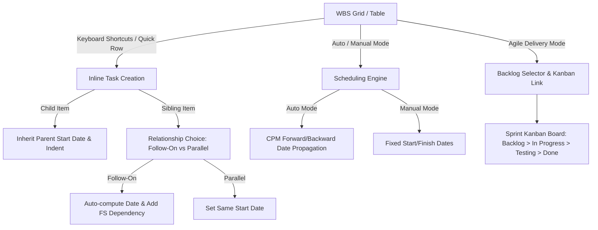

# Requirements

### Overview & Goals
Enhance the Eisenhower Portfolio Manager WBS & Gantt chart with:
1. **Automatic vs. Manual Scheduling**: Auto-scheduling as default, where dependencies and durations dynamically compute task dates, with an option to pin tasks to manual scheduling.
2. **Inline Task Creation**: Fast keyboard-driven (`Insert` for sibling, `Ctrl+Enter` for child) and inline row creation directly in the grid without modal popups.
3. **Smart Hierarchy & Date Inheritance**: Child items inherit parent start dates and indent underneath; sibling items inherit sibling metadata and offer Follow-On (default) or Parallel scheduling.
4. **Agile Delivery & Backlog/Kanban Integration**: Seamlessly connect Agile work items to designated or new backlogs and provide direct interactive transitions to standard Sprint Kanban boards.
5. **Duration as First-Class Field**: Duration must be a native property of every work item, stored in the `duration_days` database column, not in `custom_attributes`. All UI components must read from and write to this field consistently.

---

### Scope
- **In Scope**:
  - Auto/Manual scheduling toggle and date propagation in `useScheduleStore` and `app/routers/schedule.py`.
  - Inline row insertion for child and sibling tasks with correct ltree path, order, and indentation.
  - Sibling relationship prompt / radio options (Follow-On vs. Parallel).
  - Agile delivery mode backlog selector and one-click navigation to Sprint Kanban board.
- **Out of Scope**:
  - Full third-party Jira bidirectional synchronization (mocked/local backlog state is supported).
  - Multi-tenant enterprise calendar exceptions engine.

---

### User Stories
- **As a Project Scheduler**, I want tasks to auto-schedule by default so that changing one duration automatically updates all downstream dates and Gantt bars.
- **As a Project Manager**, I want to press `Insert` to quickly add sibling tasks inline without opening heavy modal dialogs.
- **As a Team Lead**, I want to press `Ctrl+Enter` to quickly add child items that inherit the parent task's start date and sit indented below the parent.
- **As an Agile Delivery Lead**, I want tasks marked with Agile delivery to link directly to a Sprint Kanban board so our team can manage work items in sprints.

---

### Functional Requirements
1. **Scheduling Mode**:
   - Each WBS node has a `scheduling_mode` (`'AUTO'` or `'MANUAL'`). Default is `'AUTO'`.
   - In `'AUTO'` mode, predecessor completion dates drive start dates; duration updates drive finish dates.
   - In `'MANUAL'` mode, start and finish dates remain fixed until explicitly edited.
2. **Inline Task Creation**:
   - `Insert` key on a row creates a new sibling task below the current task at the same indentation level.
   - `Ctrl+Enter` creates a child task indented directly below the parent.
   - An inline quick-entry row activates with the task name cell focused for immediate typing.
3. **Date & Attribute Inheritance**:
   - Child tasks inherit `planned_start_date` and security classification from their parent.
   - Sibling tasks inherit delivery mode, classification, EVM technique, and security caveats from the previous sibling.
   - When creating a sibling, provide an option (or radio button indicator) to select **Follow-on** (starts after sibling with FS relationship) or **Parallel** (starts at same start date).
4. **Agile Backlog & Sprint Kanban**:
   - When a row is set to `delivery_mode: 'AGILE'`, prompt or allow selecting an existing Backlog or typing a new Backlog name.
   - Display an interactive Agile Kanban badge in the WBS row.
   - Clicking the badge or selecting "Open Sprint Board" opens the Kanban board filtered to that backlog/task.
   - Kanban board supports backlog items, active sprint columns (`Backlog`, `In Progress`, `Testing`, `Done`), story points, and status drag-and-drop.

# Technical Design

### Current Implementation
- `WbsTable.tsx` renders virtualized WBS rows using TanStack Table and handles inline cell edits for dates, durations, predecessors, and resources.
- `useScheduleStore.ts` manages flat rows, expansion state, dependencies, and calls the backend `/api/v1/wbs/nodes` and `/api/v1/schedule/...` endpoints.
- `CreateWorkItemModal.tsx` provides a full modal dialog for task creation, currently triggered by Ribbon and shortcut actions.
- `MiniKanban.tsx` and `TaskDrillDownWorkbench.tsx` provide Kanban board views for Agile tasks based on child node completion percentages.

---

### Key Decisions
1. **Scheduling State Storage**:
   - Store `scheduling_mode` in `custom_attributes.scheduling_mode` (with fallback to `'AUTO'`) to maintain backwards compatibility with existing database models without requiring destructive schema migrations.
2. **Inline Drafting Pattern**:
   - Use a temporary draft node state in `useScheduleStore` with an optimistic ID (e.g. `draft-${Date.now()}`) that allows direct inline keyboard editing and persists to `POST /api/v1/wbs/nodes` on commit / blur.
3. **Agile Backlog Linking**:
   - Store backlog association in `custom_attributes.backlog_id` and `custom_attributes.backlog_name`.
   - Wire the row's Agile badge to open the `TaskDrillDownWorkbench` tab or a dedicated `SPRINT_KANBAN` workspace tab.

---

### Proposed Changes

#### 1. Auto/Manual Scheduling Engine
- In `frontend/src/types/wbs.ts`: Add `SchedulingMode = 'AUTO' | 'MANUAL'` to `WBSNode` and `WBSRow`.
- In `frontend/src/stores/useScheduleStore.ts`:
  - Implement client-side automatic date recalculation when a task's duration or predecessor dates change.
  - When a task is `'MANUAL'`, skip automatic date shifts.
- In `frontend/src/components/wbs/WbsTable.tsx`:
  - Add a "Mode" column with icons (⚡ Auto / 📌 Manual) allowing one-click toggle.

#### 2. Inline Task Insertion & Keyboard Navigation
- In `frontend/src/stores/useScheduleStore.ts`:
  - Implement `insertSiblingTask(referenceNodeId, relationshipMode)` and `insertChildTask(parentNodeId)`.
  - Calculate the next hierarchical code (e.g., child of `1.2` becomes `1.2.1` or `1.2.3`; sibling of `1.2` becomes `1.3`).
- In `frontend/src/components/wbs/WbsTable.tsx`:
  - Catch `Insert` (sibling) and `Ctrl+Enter` (child) key events during grid focus.
  - Render an inline creation row if an active draft exists and auto-focus the `name` cell.

#### 3. Sibling Relationship Selection
- Provide a lightweight popover / toolbar toggle:
  - `(o) Follow-on (default)`: automatically calculates start date = previous sibling's finish date and adds FS dependency link.
  - `( ) Parallel`: sets start date = previous sibling's start date without dependency link.

#### 4. Agile Backlog & Kanban Interaction
- In `frontend/src/components/wbs/WbsCellRenderer.tsx` and `WbsTable.tsx`:
  - When `delivery_mode === 'AGILE'`, render an Agile pill button with a Kanban board icon.
  - Clicking opens the Backlog / Sprint Kanban view for that work package.
- In `frontend/src/components/drilldown/MiniKanban.tsx` and `TaskDrillDownWorkbench.tsx`:
  - Support backlog selector (assign tasks to specific named backlogs).
  - Allow adding new user stories / backlog items directly on the Kanban board.

---

### Architecture Diagram

---

### Risks & Mitigations
- **Concurrent Tree Mutations**:
  - *Risk*: Multiple users adding tasks could cause ltree path clashes.
  - *Mitigation*: Backend `create_wbs_node` validates path uniqueness and recalculates index order under sub-tree locks.
- **Complex Dependency Loops**:
  - *Risk*: Auto-scheduling with circular dependencies could cause infinite loops.
  - *Mitigation*: The CPM engine checks for directed acyclic graph (DAG) validity before propagating dates.

# Testing

### Validation Approach
Verify all new scheduling, inline insertion, inheritance, and Agile features through frontend unit tests, integration tests, and manual verification steps.

---

### Key Scenarios
1. **Auto vs. Manual Scheduling**:
   - Verify that updating duration on an AUTO task pushes its finish date and dependent successor start dates forward.
   - Verify that toggling a task to MANUAL keeps its dates fixed even when predecessor dates change.
2. **Inline Sibling Task Creation (`Insert`)**:
   - Select a row (e.g. `1.2`), press `Insert`.
   - Verify that a new sibling (`1.3`) is inserted immediately below `1.2` at the same indent level without opening a modal.
   - Verify default Follow-on behavior sets `start_date` = `1.2 finish_date` and creates an FS dependency.
3. **Inline Child Task Creation (`Ctrl+Enter`)**:
   - Select a parent row (e.g. `1.2`), press `Ctrl+Enter`.
   - Verify that child `1.2.1` is inserted below `1.2`, indented one level deeper, and inherits the parent's start date.
4. **Agile Backlog & Sprint Kanban**:
   - Set a task's delivery mode to `AGILE`.
   - Select or enter a backlog name.
   - Click the Kanban badge on the WBS row.
   - Verify that the Kanban board opens, displays sub-tasks as cards, and allows dragging cards across `Backlog` -> `In Progress` -> `Testing` -> `Done`.

---

### Test Suite Execution
- Run `npm test` in `frontend/` to execute Vitest/Jest unit tests for `useScheduleStore`, `InlineEditCell`, and `WbsTable`.
- Verify `npm run build` compiles cleanly with zero TypeScript errors.

# Delivery Steps

### ✓ Step 1: Implement Auto and Manual Scheduling Engine
Add scheduling mode support (Auto vs. Manual) across backend and frontend schedule stores.

- Define scheduling mode schema (`scheduling_mode: 'AUTO' | 'MANUAL'`, defaulting to `'AUTO'`) in WBS type definitions and custom attributes.
- Add Auto/Manual scheduling indicator column and toggle action in `WbsTable.tsx` and `InlineEditCell.tsx`.
- Update `useScheduleStore.ts` to automatically cascade dates for predecessor-dependent auto-scheduled tasks upon duration or date edits.
- Add unit/store tests for Auto vs. Manual date cascades.

### ✓ Step 2: Implement Inline Task Creation and Keyboard Shortcuts
Implement quick inline task insertion for sibling and child rows without opening the authoring modal.

- Add inline creation actions (`insertChildTask`, `insertSiblingTask`) to `useScheduleStore.ts` that calculate appropriate ltree paths, depth indents, and parent IDs.
- Render inline quick-add draft rows in `WbsTable.tsx` and focus the name/code input cell immediately on creation.
- Keep `CreateWorkItemModal` wired to explicit Ribbon / context menu actions for advanced multi-tab editing.
- Wire keyboard shortcuts (`Insert` for sibling, `Ctrl+Enter` for child, `Tab` for indent, `Shift+Tab` for outdent).

### ✓ Step 3: Implement Sibling & Child Inheritance and Relationship Options
Implement property inheritance rules and relationship configuration for new items.

- Inherit parent start date and classification for child items upon creation.
- Inherit sibling classification, delivery mode, and custom attributes for sibling items upon creation.
- Add an interactive creation prompt / radio selector for sibling creation: Parallel (same start date) vs. Follow-On (predecessor finish + FS link, default).
- Ensure new child rows are inserted immediately beneath the parent and expand the parent node if collapsed.

### ✓ Step 4: Implement Agile Delivery Backlog and Kanban Integration
Connect Agile work packages to backlog selection, backlog creation, and standard Sprint Kanban boards.

- Add backlog selector / new backlog input in `WbsTable.tsx` and `TaskDrillDownWorkbench.tsx` when `delivery_mode` is set to `AGILE`.
- Store backlog identifiers and names in `custom_attributes.backlog`.
- Add an interactive Agile / Kanban badge on WBS rows that opens the Sprint Kanban board scoped to the task's backlog.
- Enhance `MiniKanban.tsx` and `WorkspaceContainer.tsx` to support backlog filtering, story card creation, and drag-and-drop status transitions across Backlog, In Progress, Testing, and Done.

### ✓ Step 5: Consolidate Duration as First-Class Field
Ensure `duration_days` is used consistently across all components instead of being stored in `custom_attributes`.

- Update `WbsTable.tsx` Duration column to display `row.duration_days` directly (falling back to computed dates only when `duration_days` is null).
- Ensure `handleCustomFieldCommit` for duration only writes to `duration_days` (already done), and does not write to `custom_attributes`.
- Verify `MiniKanban.tsx`, `SprintCardDetail.tsx`, and `CreateWorkItemModal.tsx` all read from and write to `duration_days` consistently (already confirmed).
- Run automated health checks to verify no regression.

### ✓ Step 6: End Date = Start + Duration + Lag (Workdays) — Consistent Everywhere
Ensure `planned_end_date` is always computed as `start_date + duration_days + lag_days` using workdays, across all frontend components and the backend. When the user edits the end date directly, show a popup asking whether to adjust the duration or add lag.

- **Backend `wbs.py`**: Always auto-compute `planned_end_date` from `start + duration + lag` on both create and update, even when `planned_end_date` is explicitly provided (to enforce the invariant server-side).
- **Frontend `CreateWorkItemModal.tsx`**: Keep all 3 fields (start, finish, duration) editable. When finish date is edited directly, show a small popup asking "Adjust duration or add lag?". Auto-compute finish from start + duration + lag on any change.
- **Frontend `WbsTable.tsx`**: When end date is edited inline, show the same popup. Compute the difference in workdays between the old and new end date, then either adjust duration or add lag based on the user's choice.
- **Frontend `MiniKanban.tsx`**: Already uses `addWorkdays` correctly. Verify consistency.
- **Frontend `SprintCardDetail.tsx`**: Already uses `addWorkdays` correctly. Verify consistency.
- **New `EndEditChoiceModal.tsx`**: A small modal component that asks "Adjust duration or add lag?" with two buttons, used by both WbsTable and CreateWorkItemModal.
- **`scheduleCalculator.ts`**: Add `computeDurationFromDates()` to calculate workday duration between two dates (reverse of `computeFinishDate`).
- Run automated health checks to verify no regression.